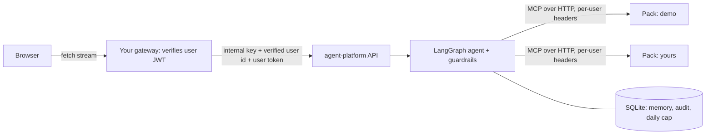

# agent-platform

Reusable chat agent service: **LangChain v1 / LangGraph agent + MCP tools**, per-user auth passthrough, guardrails, SQLite memory, SSE streaming. Domain logic lives in pluggable **MCP tool packs**; this repo has no product-specific code.



## Quick start (standalone demo)
```bash
cp .env.example .env   # set GROQ_API_KEY
docker compose up --build   # http://localhost:8000
```
Local dev:
```bash
pip install -e ".[dev]" && pytest -q          # API tests
cd ui && pnpm install && pnpm test && pnpm build   # UI (React 19, Vite, Tailwind 4, zustand)
pnpm dev                                          # UI on :5173, proxies /v1 to the API on :8000
```
The UI is a reusable component: pass your own `api={{ getHeaders }}` to `<App />` to embed it behind real auth.

## Status (only what is built and tested)
| Feature | State |
|---|---|
| MCP tool loading from config file, per-request user headers | Built, tested against a live MCP server |
| React chat UI: streaming, markdown (raw HTML off), tool chips, stop, conversations sidebar, history reload | Built, 9 tests, production build verified |
| SSE streaming (token, tool_start, tool_end, done) | Built, tested |
| SQLite memory, thread ids namespaced by verified user id | Built, tested |
| Guardrails: untrusted tool-result framing, secret redaction, injection flag, step limits, daily cap, kill switch, audit log | Built, tested |
| Provider fallback chain (primary model, then fallbacks on 429 or 5xx) | Built, tested with a fake failing model |
| `scripts/check_model.py` (tool-calling + latency check per provider) | Written, **not yet run against real APIs** |
| Real Groq/NVIDIA model run, Docker compose run | Config written, **not yet verified end to end** |
| Human approval for risky actions, RAG, evals, tracing, latency/cost numbers | Planned |

## Security model
- Only a gateway holding `AGENT_INTERNAL_KEY` can call `/v1/chat`. The user id comes from the gateway, never from the client.
- The user token is opaque, used only as an MCP header, never logged or stored.
- Tool output is data, not instructions: wrapped as `<tool_result trust="untrusted">`, redacted, truncated, injection-flagged.
- `AGENT_DEMO_MODE` bypasses the gateway for the demo UI. Never enable it in production.
